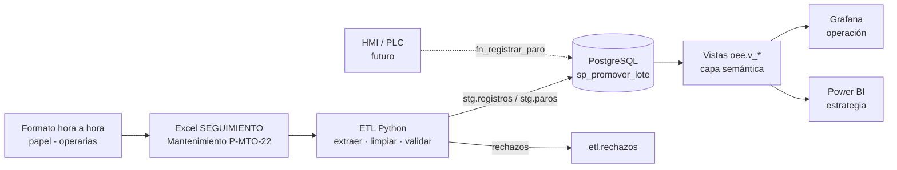
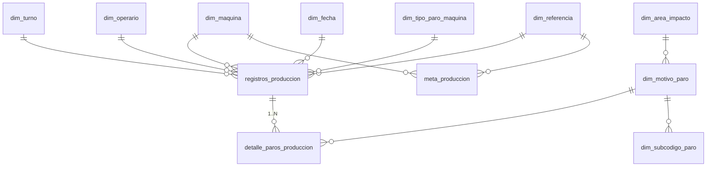

# 1. Arquitectura y modelo de datos

## Flujo extremo a extremo

## Modelo (estrella con detalle subordinado)

| Tabla | Grano / contenido |
|---|---|
| `registros_produccion` (hechos) | una fila del libro: fecha, máquina, turno, operaria, referencia, pacas, horas programadas, horas no programadas. `tipo_registro` = `PRODUCCION` o `COMPLEMENTO_PAROS` (líneas extra de paros del mismo turno) |
| `detalle_paros_produccion` | un código de paro (1–18) por registro, con minutos, subcódigo, área/personal involucrado y, opcionalmente, `inicio/fin` |
| `dim_motivo_paro` | los 18 códigos de P-MTO-22 + `es_planificado` y categoría OEE |
| `dim_subcodigo_paro` | jerarquía de los códigos 1 (sistemas y componentes), 3 y 5 |
| `meta_produccion` | pacas/hora por máquina (y referencia); `origen` = OFICIAL o ESTIMADA_P90 |

Decisiones de diseño: PK por identidad; FK en todo; fila `0 = Sin dato` en turno/operaria/referencia (la estrella no queda con huecos);
`row_hash` UNIQUE como llave de idempotencia; `EXCLUDE USING gist` para el no solapamiento; índices B-tree compuestos + BRIN por fecha.

## Reglas en la base de datos (`03_logica_negocio.sql`)
| Regla | Mecanismo |
|---|---|
| Paros de una máquina no se solapan en el tiempo | restricción `EXCLUDE` + `fn_registrar_paro` (mensaje claro) |
| Minutos = fin − inicio; fin > inicio | trigger `fn_detalle_before` |
| Subcódigo pertenece a su código | mismo trigger |
| Σ paros ≤ tiempo de turno (+5 min) | trigger `fn_detalle_after` → marca `REVISAR` (no bloquea la carga histórica) |
| No conformes ≤ producidas | trigger `fn_registro_validar` |
| Auditoría de cambios | `audit.fn_log` en hechos (UPDATE/DELETE de campos de negocio), `dim_motivo_paro` y `meta_produccion` |
| Carga sin duplicados | `row_hash` + `etl.fn_iniciar_lote` (SHA-256 del archivo) + `ON CONFLICT` |

## ETL (`etl/etl_paros.py`)
1. Lee `Base De Datos` (encabezado fila 9). 2. Normaliza (subcódigos sucios, numeración 4.x legada → 5.x, tipos de paro históricos).
3. Des-pivota las 18 columnas *Codigo de paro N* (**están en minutos**; las columnas "en horas" son fórmulas). 4. Valida (R01–R10, tabla en `docs/02`).
5. Carga a `stg.*` y llama `etl.sp_promover_lote` (una transacción). 6. Cualquier excepción queda en `etl.lotes` con estado `ERROR`.
Reejecutar el mismo archivo no hace nada; un archivo con filas nuevas inserta solo las nuevas; `--reemplazar-desde` re-sincroniza correcciones.

## Capa de visualización
* **Grafana** (`grafana/`): datasource y tablero provisionables por archivo (12 paneles: OEE/A/P/Q, tendencia, ranking por máquina, Pareto + tabla ABC, apilado por área, frescura del ETL) y 5 alertas (`alertas.md`).
* **Power BI** (`powerbi/`): consultas M sobre las vistas, esquema en estrella (`Fact_Turno`, `Fact_Paros`, `Fact_HorasNoProgramadas` ↔ dimensiones) y ~35 medidas DAX (OEE, inteligencia de tiempo, Pareto acumulado, MTBF/MTTR, TEEP).
  Relaciones: `Dim_Fecha[fecha]→Fact_*[fecha]`, `Dim_Maquina`, `Dim_Turno`, `Dim_Operaria`, `Dim_Referencia` por su `*_id` (1→*, filtro único); `Dim_MotivoParo[motivo_id]→Fact_Paros[motivo_id]`.
